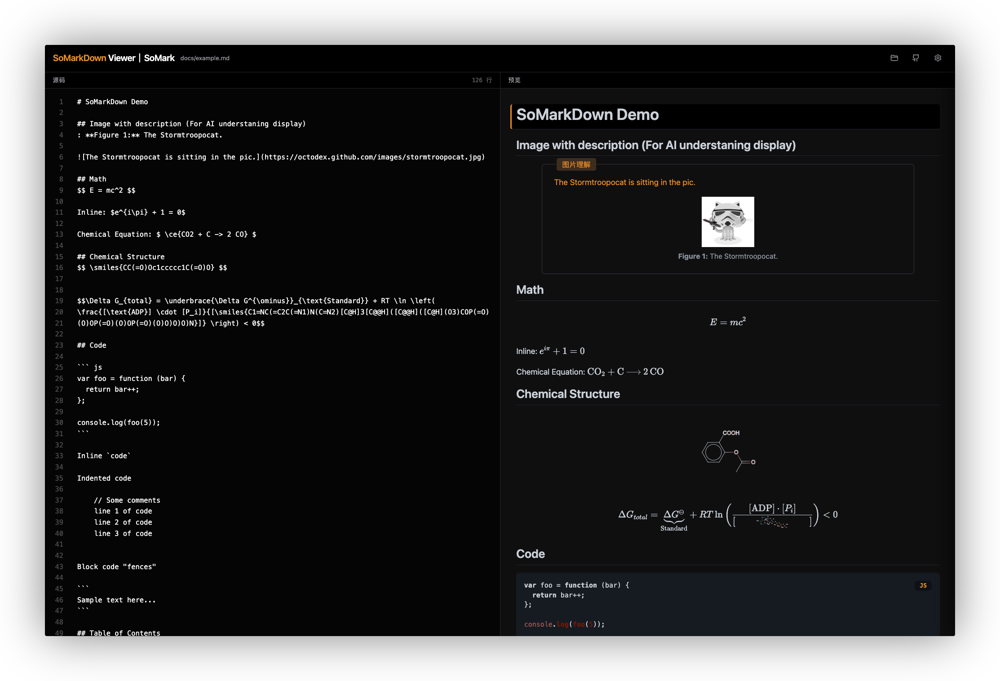

<div align="center">
<h1>SoMarkDown</h1>

English ｜ [中文](./README_CN.md)

[](https://www.npmjs.org/package/somarkdown)
[](https://github.com/SoMarkAI/SoMarkDown/blob/master/LICENSE)
<a href="https://github.com/SoMarkAI/SoMarkDown/pulls"></a>

Quick Try: https://somark.ai/smd/


<span style="font-size: 12px; color: gray;">This is [SoMarkDownViewer](https://github.com/SoMarkAI/SoMarkDownViewer) screenshot</span>

</div>

SoMarkDown is a Markdown superset built upon [markdown-it](https://github.com/markdown-it/markdown-it), providing enhanced support for professional rendering capabilities including mathematical formulas, chemical structures (SMILES), code syntax highlighting, and more.

SoMarkDown was established with the dual objective of delivering a powerful and flexible Markdown rendering solution for professional users while providing LLMs with a concise, unambiguous, and easily parsable Markdown standard. SoMarkDown also serves as the target protocol for parsing results in the [SoMark](https://somark.ai/) document intelligence parsing product.

**🧬 Key Features:**
- **Markdown Superset**: Compliant with CommonMark specification, fully compatible with standard Markdown.
- **Paragraph Mapping**: Automatic injection of line number attributes, enabling essential functionalities like synchronized scrolling and mapping navigation similar to VSCode's Markdown implementation.
- **High-Speed Rendering**: Optimized based on markdown-it, delivering fast rendering performance with support for large document processing.
- **Multiple Themes**: Built-in support for various themes (light, dark, academic style).
- **Universal Compatibility**: Supports both browser and Node.js server-side rendering.

**✨ Specialized Components:**
- **📐 Mathematical Formulas**: Integrated [KaTeX](https://katex.org/) support for LaTeX mathematical expressions, including `mhchem` chemical equation extensions. HTML table cells preserve the original LaTeX in `$...$` and `$$...$$`, including `<`, `>` and `&`, alongside embedded HTML. Inline formulas also work inside tags such as `<span>` and `<strong>`.
- **🧪 Chemical Structures**: Integrated [SmilesDrawer](https://github.com/reymond-group/smilesDrawer) for rendering SMILES strings. Innovatively supports syntax merging between LaTeX and SMILES, significantly expanding chemical structure expression capabilities.
- **🎨 Code Syntax Highlighting**: Automatic detection and highlighting of code blocks through [highlight.js](https://highlightjs.org/).
- **📑 Table of Contents Generation**: Automatic generation of table of contents (TOC).
- **🖼️ Image Understanding**: Support for image comprehension and display.
- **🏷️ Caption Support**: Support for figure and table caption expressions.

Strictly speaking, SoMarkDown is a compiler that compiles syntax-compliant strings into HTML. To handle display and visual editing, we have also developed the [SoMarkDownViewer](https://github.com/SoMarkAI/SoMarkDownViewer) editor to handle these tasks. We also provide the Gradio plugin [gradio-somarkdown](https://github.com/SoMarkAI/gradio_somarkdown), which can replace the Markdown component in Gradio.

## Installation

Install via npm:

```bash
npm install somarkdown
```

For browser usage, include via CDN:

```html
<script src="https://cdn.jsdelivr.net/npm/somarkdown/dist/somarkdown.js"></script>
<link rel="stylesheet" href="https://cdn.jsdelivr.net/npm/somarkdown/dist/somarkdown.css">
```

Build from source:

```bash
git clone https://github.com/SoMarkAI/SoMarkDown.git
cd somarkdown
npm install
npm run build
```

### Publish the browser demo

Never serve the repository checkout, `node_modules`, or the library's development
`dist` directory as a website. Build a dedicated, disposable artifact instead:

```bash
npm ci
npm run build:site
tar -C site -czf somarkdown-site.tar.gz .
```

`site/` contains the browser bundles, generated CSS, and the
`example/browser` runtime files (including the theme stylesheet and example
data). JavaScript used by the browser is intentionally retained. Source maps,
Git metadata, source modules, package manifests, and development configuration
are not published. Each build replaces the previous artifact, and missing
required assets fail the build. `npm run build` still produces library builds
with source maps for local development.

For an isolated Nginx deployment:

```bash
docker build -f deploy/Dockerfile -t somarkdown-site .
docker run --rm -p 127.0.0.1:8001:8001 somarkdown-site
```

Open `http://127.0.0.1:8001/`; it redirects to
`/example/browser/index.html`. The final image copies only `site/` into
`/usr/share/nginx/html`, not the build workspace. Do not bind-mount the checkout
over that directory. For an existing Nginx installation, extract the artifact
into a new, empty release directory **outside the checkout** and set the
`root` in `deploy/nginx.conf` to that directory; retain the redirect and
`try_files` behavior. Switch releases only after checking the page and all local
assets. Do not merge the artifact into a former source-root publication.
The demo's existing external CDN styles/fonts and example image still require
network access.

For example, when migrating an existing source-root deployment (operator-run;
do not run these commands on a live host without a release review):

```bash
release=/srv/somarkdown/releases/$(date -u +%Y%m%dT%H%M%SZ)
mkdir -p "$release"
tar -xzf somarkdown-site.tar.gz -C "$release"
```

Set the existing site's Nginx `root` to that exact `$release` path, preserving
its listener and root redirect, then run `nginx -t` before a controlled reload.
The artifact retains `/dist/somarkdown.umd.js` as well as the minified bundle,
so older browser demo HTML can keep its existing script URL. The library
version still changes when migrating from older releases: validate rendering
and theme controls before switching; copying this release does not certify
equivalence with an older deployed version.

Run packaging regressions with `npm test -- --runInBand`; after building, verify
that `/example/browser/index.js`, `/example/example_data.js`,
`/dist/somarkdown.umd.min.js`, and `/dist/somarkdown.css` return 200, while
`/.git/config`, `/package.json`, `/src/core/config.js`, and
`/dist/somarkdown.umd.min.js.map` return 404.

## Usage

### Basic Usage

> The project includes a browser example in `example/browser`. After compilation, you can directly open `example/browser/index.html` to view the demonstration.

Usage example in code:

```javascript
import SoMarkDown from 'somarkdown';
import 'somarkdown/dist/somarkdown.css'; // Import base styles

const somarkdown = new SoMarkDown({
  lineNumbers: {
    enable: true
  }
});

const markdown = `
# SoMarkDown Demo

## Math
$$ E = mc^2 $$

Inline: $e^{i\\pi} + 1 = 0$

## Chemical Structure
$$\\smiles{CC(=O)Oc1ccccc1C(=O)O}$$

## Chemistry (mhchem)
$$ \\ce{CO2 + C -> 2 CO} $$
`;

const html = somarkdown.render(markdown);
console.log(html);
```

### Configuration

You can pass a configuration object to the constructor:

```javascript
const config = {
  linkify: true,     // Automatically convert URL-like text to links
  typographer: true, // Enable language-neutral replacements + quotes beautification
  
  // Core functionality configuration
  imgDescEnabled: true, // Whether to display image descriptions
  lineNumbers: {
    enable: true,    // Enable source code line number injection (for bidirectional synchronization)
    nested: true     // Whether to inject line numbers for nested blocks (list items, quotes, etc.)
  },

  // Plugin configuration
  katex: {
    throwOnError: false,
    errorColor: '#cc0000'
  },
  toc: {
    includeLevel: [1, 2, 3]  // Heading levels to include in TOC
  },
  smiles: {
    disableColors: false,  // Whether to disable colors in SMILES rendering
    width: 300,
    height: 200
  }
};

const somarkdown = new SoMarkDown(config);
```

Full configuration options are available in `src/core/config.js`.

## Themes

SoMarkDown includes built-in themes that can be imported via `somarkdown.css`. Apply theme classes to containers:
- `theme-light`: Light theme (default), suitable for general reading.
- `theme-dark`: Dark theme designed for low-light environments, featuring deep colors and high contrast.
- `theme-academic`: Academic-style theme optimized for research papers, with strong color contrast and larger fonts.

## API Reference

### `new SoMarkDown(config)`

Creates a new instance.

### `render(src: string): string`

Renders Markdown source code to HTML string.

## License

MIT

## WeChat Group

